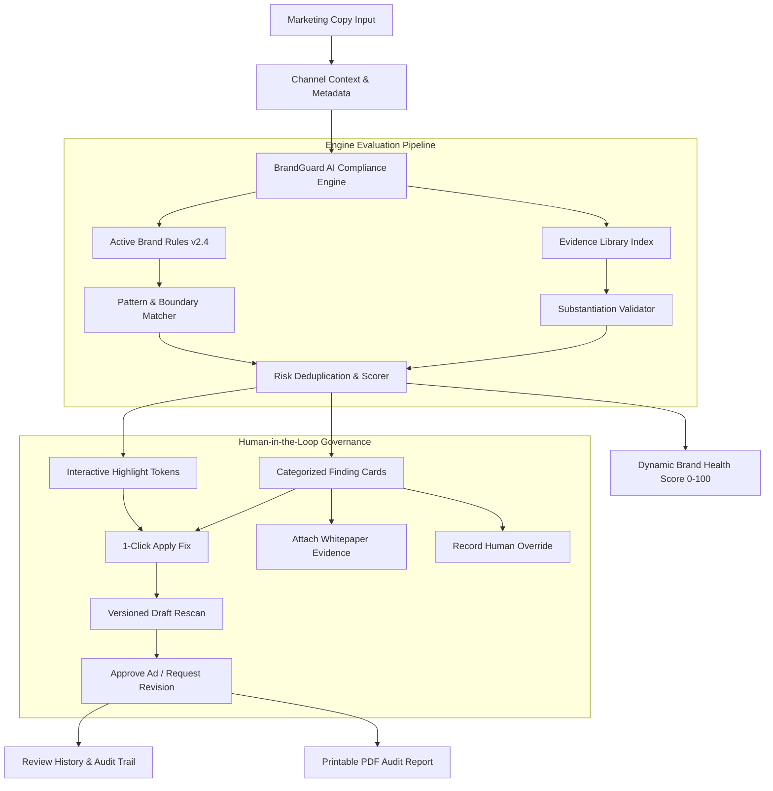

# BrandGuard AI — Marketing Compliance & Brand Governance Platform

<div align="center">


**An intelligent brand governance and automated marketing content compliance platform engineered for modern enterprise scale.**

[🌐 Live Demo App](https://keen-beignet-8f6a00.netlify.app/) • [GitHub Repository](https://github.com/arpanbasak90-cyber/Codex-48) • [Architecture](#-system-architecture--how-it-works) • [Problem Statement](#-the-problems-it-solves) • [User Personas](#-target-users--personas)

</div>

---

## 📖 Executive Summary: Why BrandGuard AI?

In hyper-growth enterprises, marketing and growth teams publish hundreds of ad variants, social updates, search snippets, and landing pages across dozens of channels every week. Meanwhile, brand standards, legal disclaimers, and technical product claims are buried in static PDF guidelines or outdated wiki pages.

This disconnect creates severe friction:
- **High-Velocity vs. High-Risk:** Moving fast often leads to unsubstantiated superlative claims (e.g., *"#1 fastest cloud database"*), illegal performance guarantees (*"10x guaranteed"*), or obsolete product naming.
- **The Legal Bottleneck:** Legal and compliance reviews are manual, slow, and expensive, delaying critical campaign launches by days or weeks.
- **Brand Dilution:** Inconsistent messaging, unapproved terminology, and unverified performance metrics erode customer trust and enterprise credibility.

**BrandGuard AI bridges this gap.** It acts as an automated, continuous compliance copilot that sits between creative drafting and public distribution—validating marketing copy against approved brand guidelines, technical SLAs, and substantiating evidence records in milliseconds.

---

## 🎯 The Problems It Solves

| Challenge | Real-World Impact | How BrandGuard AI Solves It |
| :--- | :--- | :--- |
| **FTC & Regulatory Scrutiny** | Fines and mandatory retractions from unsubstantiated comparative or superlative claims (e.g., *#1 ranking*). | Flags unverified claims immediately and cross-checks them against indexed third-party benchmarks and whitepapers. |
| **Legal Breach of Contract** | Promising absolute uptime (*"without downtime"*) or financial returns (*"10x guaranteed"*) without contract SLAs creates massive legal liability. | Distinguishes between colloquial claims and contractual obligations, enforcing official SLA tiers (*99.99% uptime availability*). |
| **Trademark Dilution** | Marketing teams accidentally promoting deprecated or unregistered product names (*Acme Cloud Platform* instead of *Acme CloudSphere™*). | Automated glossary enforcement identifying registered trademark violations and one-click brand standard fixes. |
| **Channel Disclaimer Omissions** | B2B social feeds (e.g., LinkedIn Sponsored Ads) require specific disclaimers that search snippets do not. | Context-aware channel evaluation (e.g., *LinkedIn Ad* triggers mandatory metrics disclaimers). |
| **Review Drag & Audit Blindspots** | Endless email threads and Slack messages negotiating copy revisions with no audit history. | Full version history, one-click fix application, rescan validation, and tamper-proof audit trails for legal sign-off. |

---

## 👥 Target Users & Personas

BrandGuard AI is built for cross-functional collaboration between marketing, brand, and legal stakeholders:

### 1. ✍️ Copywriters, Growth Marketers & Performance Ad Managers
* **Pain Point:** Uncertainty whether their copy violates corporate policy or requires special legal disclosures.
* **Workflow:** Pastes draft copy into **New Review**, instantly sees color-coded highlight feedback, applies AI-compliant suggestions with one click, and submits pre-validated copy.

### 2. 🛡️ Brand Governance & Communications Directors
* **Pain Point:** Difficult to keep distributed global marketing teams aligned with updated brand voice, tone, and trademark standards.
* **Workflow:** Configures and enforces rules in **Brand Guidelines**; toggles active baselines that instantly govern all future scans across all teams.

### 3. ⚖️ Corporate Counsel & Legal Compliance Teams
* **Pain Point:** Wasting billable hours reviewing basic nomenclature errors and hunting down missing whitepapers for performance claims.
* **Workflow:** Uses **Analysis Results** to verify substantiated claims (`SLA-2025-V2`), review human exception overrides, and export printable **Compliance Audit Reports** for compliance archiving.

### 4. 🚀 Product Marketing Managers (PMMs)
* **Pain Point:** Product capabilities, speed benchmarks, and certifications evolve rapidly across product releases.
* **Workflow:** Maintains the **Evidence Library** with verified SOC 2 audit reports, analyst benchmarks (Gartner/IDC), and architecture whitepapers.

---

## ⚙️ System Architecture & How It Works



### The 6-Step Governance Workflow:
1. **Submission & Context:** The user provides a Campaign Name, selects the Target Channel (*e.g., LinkedIn Ad*), enters the headline and copy, and optionally attaches creative assets.
2. **Deterministic Multi-Category Scan:** The modular TypeScript compliance engine evaluates the text against active brand rules:
   - **Prohibited Guarantees (Critical):** Regex boundaries intercept unqualified promises (*"10x guaranteed"*).
   - **Comparative Market Claims (Warning):** Flags superlative statements lacking audited third-party citations.
   - **Trademark & Product Nomenclature (Suggestion):** Detects deprecated naming and suggests registered trademark formats (*Acme CloudSphere™*).
   - **Tone & SLA Alignment (Suggestion):** Suggests enterprise contractual precision (*99.99% availability*) over casual claims (*"without downtime"*).
3. **Evidence Cross-Referencing:** The engine checks whether the claim matches verified entries in the **Evidence Library**. If an SLA document exists (`SLA-2025-V2`), the claim is marked **Verified & Fully Compliant** instead of flagged.
4. **Interactive Highlighting & Health Scoring:**
   - Text is parsed into interactive tokens color-coded by severity (Red: Critical, Amber: Warning, Purple: Tone/Trademark, Green: Verified).
   - The **Brand Health Score** is computed dynamically from weighted deductions.
5. **1-Click Correction & Versioned Rescan:**
   - Clicking **"Apply Fix"** performs an index-safe replacement directly in the copy.
   - Creates a new revision version (`Version 2`) and re-scans the text, demonstrating real-time score recovery.
6. **Final Sign-off & Audit Logging:**
   - Reviewers can mark items reviewed, attach external evidence whitepapers, log exception overrides, or dispatch the review to legal with complete audit log persistence.

---

## ✨ Key Screens & Features

### 1. Dashboard Overview
* **Dynamic Metric Cards:** Live aggregation of Total Reviews, Action Queue Claims, Pending Approvals, and Completed Reviews.
* **Active Policy Guard Banner:** Shows `Acme Global 2025 v2.4 (Enforced)`, rule counts, synced evidence whitepapers, and real-time policy drift status.
* **Review History Table:** Filter by status (*Action Required*, *Approved*), search by campaign name, view finding pill breakdowns, and jump directly to results.

### 2. New Review Form
* **Preset Loaders for Instant Evaluation:**
  - *Sample Ad (Flagged):* Reproduces the test copy with absolute guarantee, unverified claim, and tone flag.
  - *Enterprise Copy:* Multi-sentence enterprise ad covering all four finding categories.
  - *Compliant Ad (Pass):* Fully compliant copy achieving a 100/100 score.
* **Live Word & Character Counters:** Real-time character budget indicators tailored for advertising copy.
* **Asset Uploader:** Drag-and-drop banner uploader with 25MB validation for PNG, JPG, and SVG assets.

### 3. Analysis Results View
* **Score Meter:** Smooth SVG circular gauge visualizing overall Brand Health Score.
* **Evaluated Copy Snippet:** Interactive inline tokens linking directly to corresponding finding cards.
* **Detailed Finding Cards:**
  - Original claim blockquote.
  - Plain-English **Clarification Note** explaining regulatory & brand policy context.
  - **Evidence Reference** note detailing whitepaper searches or SLA attachments.
  - AI Suggested Replacement with **Copy**, **Apply Fix**, **Attach Evidence**, **Mark Reviewed**, and **Override** actions.
* **Sticky Bottom Progress Bar:** Tracks resolved actionable items and enables batch actions.

### 4. Brand Guidelines Manager
* Active policy version control (`Acme Global Baseline v2.4`).
* Categorized rules: Prohibited Guarantees, Superlatives, Trademark Nomenclature, Tone & SLA Clarity.
* Instant rule activation toggles and custom rule creation modal.

### 5. Evidence Library
* Centralized repository of technical SLAs, benchmark whitepapers, and product catalog guidelines.
* Verified, Unverified, and Disputed status tracking.
* Adding or modifying evidence records directly affects future scan evaluations.

### 6. Review History & Export
* Searchable and filterable archive of all historical campaign scans.
* Full revision history tracking across content drafts.
* **Printable Compliance Audit Report** modal formatted for PDF export (`window.print()`).

---

## 🛠️ Technology Stack

| Layer | Technology | Rationale |
| :--- | :--- | :--- |
| **Frontend Framework** | **React 19** | Modern component architecture, declarative state, and strict typing. |
| **Build Tool & Bundler** | **Vite 6** | Sub-second HMR, optimized production tree-shaking, fast dev builds. |
| **Language** | **TypeScript 5.8** | Type safety across rule models, evidence schemas, and compliance results. |
| **Styling & Design System** | **Custom Vanilla CSS** | Precision enterprise design system matching the Google Stitch UI specifications without CSS bloat. |
| **Icons** | **Lucide React** | Clean, accessible SVG iconography. |
| **Testing** | **Vitest** | Blazing-fast unit testing running in parallel directly in the Vite pipeline. |
| **Persistence** | **LocalStorage API** | Browser-safe persistence with zero-dependency demo initialization and reset capabilities. |
| **Deployment** | **Vercel** | SPA client-side rewrite configuration (`vercel.json`) ready for one-click deployment. |

---

## 🧪 Automated Unit Test Suite

BrandGuard AI includes a dedicated Vitest test suite verifying the compliance engine logic under `src/engine/complianceEngine.test.ts`.

To run the tests:
```bash
npm test
```

### Verified Test Cases:
1. `✓ detects critical violations, unsupported claims, trademark and tone issues on sample copy`
   - Validates detection of *"10x guaranteed"* (`Policy 4.2`), *"voted #1 fastest"* (`FTC COMPLIANCE`), *"Acme Cloud Platform"* (`Glossary v2.4`), and *"without downtime"* (`SLA Alignment`).
2. `✓ recognizes verified SLA evidence for approved architecture claims`
   - Validates matching against `SLA-2025-V2` for *"zero scheduled downtime architecture"*.
3. `✓ returns clean score of 100 for compliant marketing copy`
   - Confirms clean ad copy produces 0 findings, 100/100 score, and `Approved` status.
4. `✓ replaces a single matched suggestion accurately in text`
   - Verifies precise index-based string substitution without corrupting neighboring text.
5. `✓ applies batch suggestions cleanly from end to start without index collisions`
   - Tests reverse-index batch application of multiple suggested replacements.
6. `✓ does not flag disabled / inactive rules`
   - Verifies that toggling a rule to inactive immediately stops flagging in scans.

---

## 🚀 Getting Started Locally

### 1. Prerequisites
- **Node.js** (v18.0.0 or higher recommended)
- **npm** (v9.0.0 or higher)

### 2. Installation
```bash
# Clone the repository
git clone https://github.com/arpanbasak90-cyber/Codex-48.git

# Navigate into the project directory
cd Codex-48

# Install dependencies
npm install
```

### 3. Run Development Server
```bash
npm run dev
```
Open **[http://localhost:5173](http://localhost:5173)** in your browser.

### 4. Build for Production
```bash
# Type check and build bundle
npm run build

# Preview production build locally
npm run preview
```

---

## ☁️ Live Deployment & Hosting

- **🌐 Live Production URL**: **[https://keen-beignet-8f6a00.netlify.app/](https://keen-beignet-8f6a00.netlify.app/)**
- **Status**: Live, operational, and accessible without login credentials.

### Deploying to Netlify / Vercel:
The repository includes SPA routing rewrite configuration in [`vercel.json`](vercel.json) and is pre-configured for instant zero-configuration deployment on both Netlify and Vercel:

```json
{
  "rewrites": [
    { "source": "/(.*)", "destination": "/index.html" }
  ]
}
```

#### Steps:
1. Connect this repository ([`https://github.com/arpanbasak90-cyber/Codex-48`](https://github.com/arpanbasak90-cyber/Codex-48)) to Netlify or Vercel.
2. Build Command: `npm run build`.
3. Output Directory: `dist`.
4. The application is instantly live with client-side SPA routing preserved across page reloads.

---

## 🗺️ Product Roadmap (Planned for Round 3)

1. **Evidence Document Ingestion & Semantic Retrieval (RAG):**
   - Connect a vector datastore (pgvector/Pinecone) to ingest full PDF whitepapers, Gartner Magic Quadrants, and SOC 2 audits, automatically extracting citations for comparative claims.
2. **Multi-User Role-Based Governance Workflows:**
   - Role-based access control (RBAC) with separate permission tiers for Copywriter (Draft), Brand Manager (Review), and Legal Counsel (Sign-Off) with cryptographic approval timestamps.
3. **Automated Visual Brand & Accessibility Analysis:**
   - Multimodal image evaluation for creative banner assets, verifying logo safe-zones, color contrast compliance (WCAG 2.1 AA/AAA), trademark watermark legibility, and unapproved imagery.

---

## 📄 License & Credits

Built as part of the **CODEX 48 Round 2 Hackathon**.  
Designed with inspiration from modern enterprise brand governance workflows and the Stitch design specifications.
